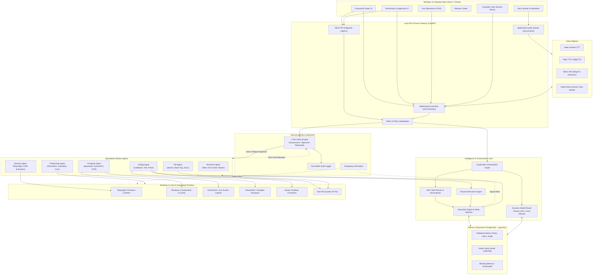
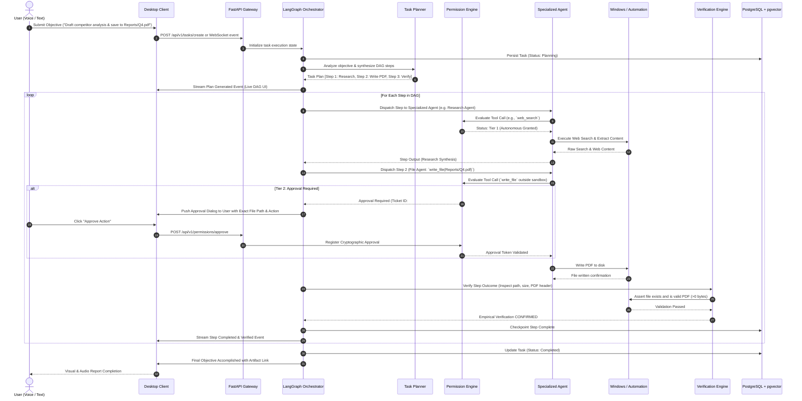
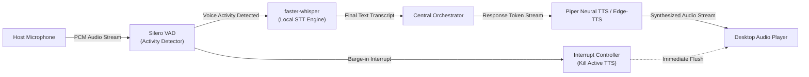
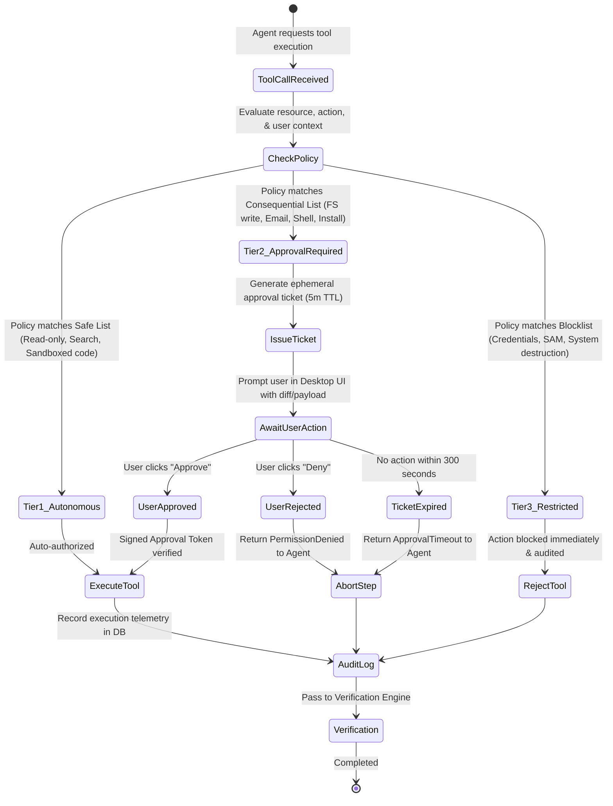

# REETA Architecture Diagrams

This document contains visual architectural specifications for the REETA autonomous personal AI operating system using standard GitHub-flavored Mermaid notation.

---

## 1. System Component Topology & Security Boundaries

---

## 2. Autonomous Task Planning & Execution Lifecycle

---

## 3. Real-Time Voice & Barge-In Audio Pipeline

---

## 4. Zero-Trust Security & Permission State Machine

