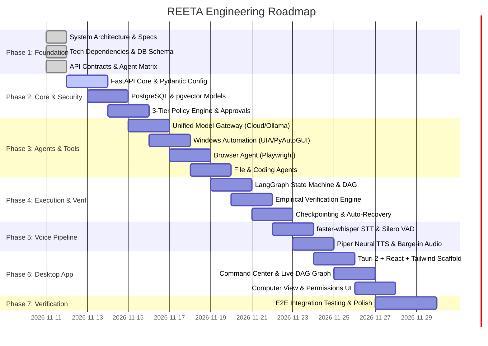

# REETA Integrated Implementation Plan & Roadmap

This document outlines the phased milestone roadmap, deliverables, validation criteria, and execution strategy for REETA.

---

## 1. Roadmap Milestones & Phases

---

## 2. Phase Breakdown & Deliverables

### Phase 1: Foundation & Architectural Baseline (COMPLETED)
- [x] Full architectural specification document (`system_architecture.md`).
- [x] Mermaid architecture diagrams for topology, task lifecycle, voice, and security.
- [x] Technology dependencies inventory with Windows 11 host verification (`technology_dependencies.md`).
- [x] PostgreSQL 16 + pgvector relational schema DDL (`database_schema.md`).
- [x] API contract specification (REST + WebSocket stream & voice protocol) (`contracts.md`).
- [x] Agent responsibility matrix & tool contracts (`agent_matrix.md`).
- [x] Zero-trust security & permission model (`security_model.md`).
- [x] Standardized repository directory structure (`repository_structure.md`).
- [x] Integrated implementation plan (`implementation_plan.md`).

### Phase 2: Backend Core, Database Layer & Security Policy Engine
- [ ] Initialize Python 3.11 virtual environment & backend scaffolding.
- [ ] Configure `app/config.py` with typed Pydantic BaseSettings and `.env` loader.
- [ ] Implement SQLAlchemy 2.0 async database models and session manager.
- [ ] Create Docker Compose for PostgreSQL 16 with pgvector extension.
- [ ] Implement `PolicyEngine` with Tier 1, Tier 2, and Tier 3 classification.
- [ ] Implement `TicketManager` with HMAC-SHA256 token verification and single-action expiration.
- [ ] Implement `AuditLogger` writing immutable execution logs.
- [ ] Implement `/api/v1/system/emergency-stop` kill-switch.

### Phase 3: Unified Model Gateway & Specialized Tool Implementations
- [ ] Build `BaseLLMProvider` and concrete adapters:
  - `OllamaProvider` (Local Llama 3, Qwen 2.5 Coder, DeepSeek R1).
  - `OpenAIProvider`, `AnthropicProvider`, `GeminiProvider`.
- [ ] Implement `ModelRouter` to dynamically choose models based on reasoning requirements.
- [ ] Implement Windows 11 Automation Tools:
  - `pywinauto` UIA inspector, window focus, control click, text typing.
  - `PyAutoGUI` / `mss` screen capture, coordinate clicks, hotkey inputs.
- [ ] Implement Browser Automation Tools:
  - Playwright async browser runner, DOM accessibility tree scraper, form fill, PDF export.
- [ ] Implement File Tools:
  - Pathlib-based safe file read, write, copy, move, directory tree indexer, path jail validator.
- [ ] Implement Research & Coding Tools:
  - Web search extractor, markdown report builder, diff patcher, Docker sandbox runner.

### Phase 4: Autonomous Execution Engine, Checkpointing & Result Verification
- [ ] Implement LangGraph state graph (`AgentState`) coordinating Orchestrator and specialized subgraphs.
- [ ] Implement `TaskPlanner` that takes natural language goals and constructs DAG step plans.
- [ ] Implement `ExecutionEngine` with parallel step execution, timeout guards, and cancellation tokens.
- [ ] Implement Checkpoint Persistence in PostgreSQL for seamless task resumption.
- [ ] Implement `VerificationEngine`:
  - Empirical verification rules for files (exists, non-zero, checksum, format parsing).
  - Verification rules for Windows UI (window presence, control state change).
  - Verification rules for coding tasks (exit code 0 on tests).

### Phase 5: Real-Time Voice Pipeline
- [ ] Implement `faster-whisper` local offline speech recognition worker.
- [ ] Implement `Silero VAD` for speech boundary detection and instant barge-in trigger.
- [ ] Implement `Piper TTS` / `Edge-TTS` streaming neural speech synthesizer.
- [ ] Implement `/ws/v1/voice` bidirectional WebSocket audio streaming endpoint.

### Phase 6: Desktop Application (Tauri 2 + React + Tailwind CSS)
- [ ] Initialize Tauri 2 project with Vite, React 18, and TypeScript.
- [ ] Configure Tailwind CSS with futuristic obsidian/navy/cyan color palette.
- [ ] Build core UI views:
  - `CommandCenter`: Central REETA visual identity, prompt input, microphone toggle, active status indicators.
  - `LiveOperations`: Visual DAG execution graph, step progress indicators, streaming reasoning logs.
  - `AgentWorkspace`: Artifacts viewer, diff inspector, markdown/code viewer.
  - `ComputerView`: Real-time screen capture viewer with click coordinate overlays.
  - `MemoryCenter`: Interactive semantic memory explorer and preference manager.
  - `Permissions`: Active human approval requests with explicit allow/deny controls.
  - `Settings`: Model selection, API keys, voice configuration.
- [ ] Implement real-time WebSocket client store (Zustand + React Query).

### Phase 7: Verification, System Testing & Release Readiness
- [ ] Write unit tests for PolicyEngine, Token verification, and DAG planner.
- [ ] Execute end-to-end multi-step task verification on Windows 11.
- [ ] Validate emergency stop kill-switch under active tool execution.
- [ ] Package desktop installer / standalone release bundle.
